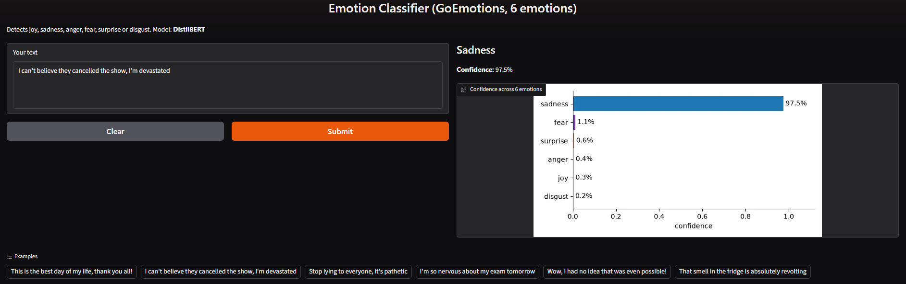
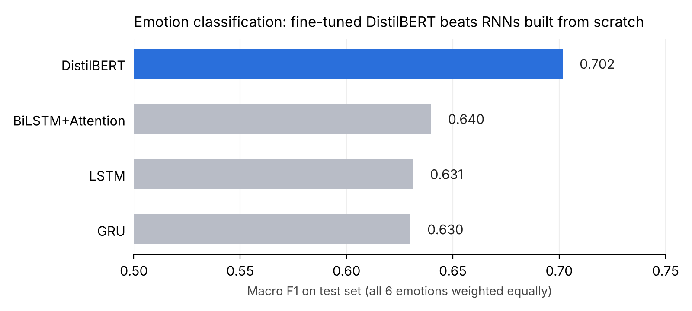
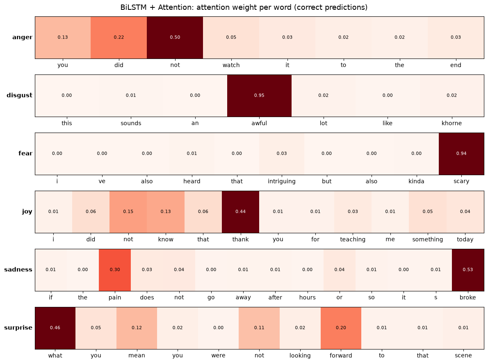
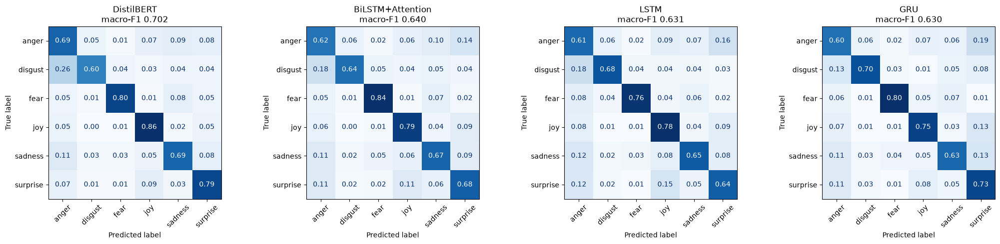

# Emotion Classification with Attention (GoEmotions)

Multi-class classifier for **6 core emotions**: joy, sadness, anger, fear, surprise and disgust.
Four architectures are compared on the same data: **LSTM**, **GRU** and **BiLSTM + Attention** (built from scratch in PyTorch with pre-trained GloVe embeddings), plus a fine-tuned **DistilBERT** (HuggingFace Trainer API). Attention weights are plotted as heatmaps to show which words drive each prediction, and the best model is deployed as a **Gradio** app.



## Results (GoEmotions test set, 3,539 comments)

| Model | Accuracy | Macro F1 | anger | disgust | fear | joy | sadness | surprise | Train time |
|---|---|---|---|---|---|---|---|---|---|
| **DistilBERT (fine-tuned)** | 0.801 | **0.702** | 0.691 | 0.511 | 0.716 | 0.900 | 0.653 | 0.739 | 1.9 min |
| BiLSTM + Attention | 0.731 | 0.640 | 0.623 | 0.539 | 0.628 | 0.852 | 0.588 | 0.609 | 0.5 min |
| LSTM | 0.718 | 0.631 | 0.594 | 0.505 | 0.653 | 0.839 | 0.612 | 0.585 | 0.3 min |
| GRU | 0.710 | 0.630 | 0.600 | 0.514 | 0.642 | 0.830 | 0.610 | 0.585 | 0.2 min |

Per-emotion columns are F1. Trained on an RTX 3060 Ti. The from-scratch models use early stopping on validation Macro F1.



**Takeaways**
- DistilBERT wins by about 6 Macro-F1 points. Pre-training on huge amounts of text helps most on short, slangy Reddit comments, and its sub-word tokenizer still reads emojis, punctuation and slang that GloVe doesn't cover.
- Among the from-scratch models, attention adds about 1 point over LSTM and GRU. More importantly, it makes the model explainable (see the heatmaps below).
- Disgust is the weakest class for every model (F1 0.51 to 0.54). It has only 524 training examples and is often confused with anger.

## Which words drive the prediction?
Attention weight per word for correctly classified test comments (darker = more attention):





## Pipeline
1. **Data:** GoEmotions (Google), 58k Reddit comments with 28 labels. The official `ekman_mapping.json` maps 27 of them to the 6 target emotions (e.g. annoyance -> anger), and `neutral` is dropped. A comment is kept only if all its labels point to exactly **one** emotion, leaving 28,104 train / 3,527 val / 3,539 test.
2. **Class imbalance:** joy is 56% of the data, while fear and disgust are about 2% each (a 30x gap). The models train with **class-weighted cross-entropy** and are compared on **Macro F1**.
3. **Cleaning:** lowercase, `[NAME]` placeholders unified, `n't` -> `not`, letters only. Stop words are **kept**, because words like "not", "so" and "never" carry emotion and the attention heatmaps need them.
4. **Embeddings:** GloVe 6B 100d, covering 89% of the vocabulary and 99.1% of word occurrences. The missing words are mostly Reddit slang (lmao, idk, upvote). Embeddings stay trainable.
5. **Custom models:** `GloVe -> LSTM / GRU (128) -> last hidden state -> 6 classes`, and `GloVe -> BiLSTM (2x128) -> additive attention -> weighted sum -> 6 classes`. Padding is masked (packed sequences, and attention scores set to -inf on padding).
6. **Attention:** `score_t = v . tanh(W h_t + b)`, then a softmax over the real words gives the weights alpha. The context vector is the sum of alpha_t * h_t.
7. **Transformer:** `distilbert-base-uncased` fine-tuned on the raw text using `AutoTokenizer`, `AutoModelForSequenceClassification` and `Trainer` (with a class-weighted `compute_loss`).
8. **Evaluation:** accuracy, Macro F1, per-class precision and recall, and row-normalized confusion matrices.
9. **Deployment:** a Gradio app that returns the dominant emotion and a confidence bar chart across all 6 classes.

## Project structure
| Path | What it is |
|---|---|
| `emotion_classification.ipynb` | full notebook with outputs |
| `emotion_utils.py` | shared code: label mapping, cleaning, vocab, GloVe, models (imported by the notebook and the app) |
| `app.py` | Gradio app |
| `make_glove_subset.py` | builds `data/glove_subset_100d.txt` from the full GloVe file |
| `data/` | GoEmotions TSVs, `ekman_mapping.json`, `emotions.txt`, GloVe subset |
| `models/` | trained LSTM / GRU / BiLSTM+Attention weights, `vocab.json`, `results.json` |
| `images/` | charts and app screenshot |

## Run it
```bash
pip install -r requirements.txt
jupyter notebook emotion_classification.ipynb   # trains all 4 models (about 4 min on a GPU)
python app.py                                   # opens http://127.0.0.1:7860
```
The DistilBERT weights (268 MB) are not included because of GitHub's file-size limit. Until you run the notebook, the app falls back to the best model included (BiLSTM + Attention).

## Limitations
- Only single-emotion comments are used (about 65% of GoEmotions). Real text often mixes emotions, and a multi-label model would cover that.
- Disgust is the hardest class: it has the fewest examples and is often confused with anger.
- GoEmotions is Reddit text from 2019, so slang and topics from other platforms may be misread.

## Data & credits
- [GoEmotions](https://github.com/google-research/google-research/tree/master/goemotions) by Google Research (CC BY 4.0)
- [GloVe](https://nlp.stanford.edu/projects/glove/) 6B 100d by Stanford NLP
- Project brief: Instant Software Solutions AI & Data Analysis training, Sprint 3
